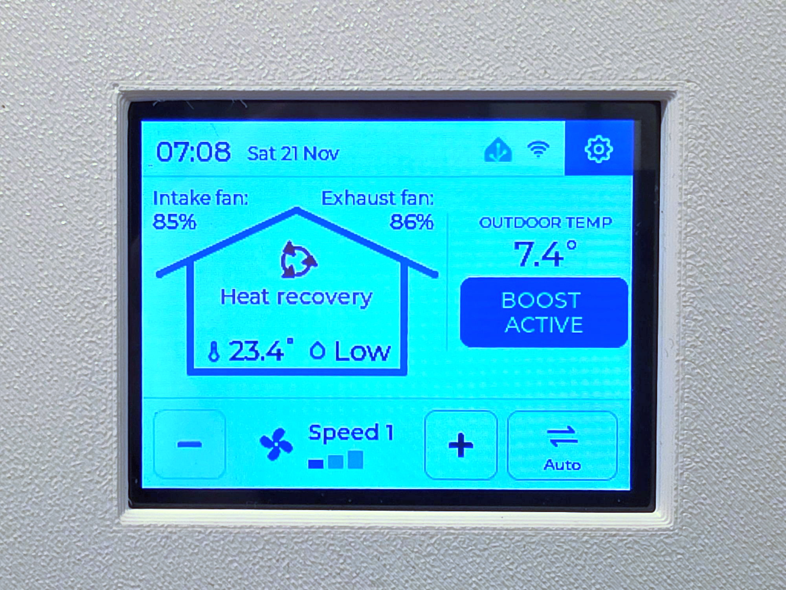

# Vectaire MVHR controller

<div align="center">
  
  <br><br>
  
  &nbsp;&nbsp;
  
</div>

ESP32 firmware that **replaces the original LCD control panel** of a Vectaire MVHR (heat-recovery ventilation) unit.
It is tested on the **Vectaire Midi** and may also work with the **Maxi**, which uses the same kind of panel (see
[MVHR units](#mvhr-units)).
The controller talks to the unit over its 12 V one-wire bus. It shows everything on its own touch screen, or works
without a screen, and you can also use it from a phone or a computer:

- **Local touch screen** (optional): home screen with temperatures, humidity, fan speed and alarms, plus menus for
  every setting the original panel had.
- **Web page** on your home network: live state, controls, settings, maintenance and diagnostics.
- **Home Assistant** through MQTT discovery. All sensors and controls appear by themselves.
- **Firmware updates over Wi-Fi**, with automatic rollback if a new version fails.

> The controller is the **only master** on the bus: it replaces the original panel, it doesn't sit next to it.
> Disconnect the original panel before you connect the controller.

---

## Contents

1. [Two variants](#two-variants)
2. [Supported hardware](#supported-hardware)
3. [Wiring to the MVHR](#wiring-to-the-mvhr)
4. [First start and Wi-Fi setup](#first-start-and-wi-fi-setup)
5. [Using the touch screen](#using-the-touch-screen)
6. [Web page](#web-page)
7. [Home Assistant](#home-assistant)
8. [Network time](#network-time)
9. [Fan speed settings](#fan-speed-settings)
10. [Not built yet](#not-built-yet)
11. [Device password](#device-password)
12. [Button and status LED](#button-and-status-led)
13. [Troubleshooting](#troubleshooting)
14. [Project layout](#project-layout)
15. [Building, flashing and updating: `idf.sh` and `ota.sh`](#building-flashing-and-updating-idfsh-and-otash)

---

## Two variants

The same code builds two variants:

| | **Display** | **Headless** |
|---|---|---|
| Board | NiceMCU C5E-DEV 2.8IPS (ESP32-C5, 2.8" touch screen) | Any ESP32, ESP32-C3, -S3, -C5 or -C6 board, 4 MB flash or more |
| Operated from | Touch screen, web page, Home Assistant | Web page, Home Assistant |
| Status shown on | Screen | A status LED (optional) |
| Wi-Fi | Optional ("Display only" mode works without it) | Required |
| Wi-Fi setup | Hotspot with a password and a QR code on the screen | Open hotspot that closes after 15 minutes |

Both variants have the same bus driver, web pages, Home Assistant integration and OTA updates.
An update can't install one variant's firmware on the other.

## Supported hardware

### Display variant

**NiceMCU C5E-DEV 2.8IPS**:
- ESP32-C5 (rev 1.2), 16 MB flash, 8 MB PSRAM,
- ST7789 320×240 IPS screen,
- CST816D touch controller.

The board's schematic, display spec and vendor demo are in [`docs/board/`](docs/board/).

### Headless variant

| Chip | Wi-Fi | Notes |
|---|---|---|
| ESP32 (classic, e.g. ESP32-D0WDQ6 DevKit) | 2.4 GHz | Wi-Fi setup and web page tested; not yet on a real bus |
| ESP32-S3 | 2.4 GHz | builds, not yet tested on hardware |
| ESP32-C3 | 2.4 GHz | builds, not yet tested on hardware |
| ESP32-C6 | 2.4 GHz | builds, not yet tested on hardware |
| ESP32-C5 | 2.4 + 5 GHz | builds, not yet tested on hardware |

PSRAM is not needed. The default pins for each chip are in [Wiring](#default-pins), and
[`docs/HEADLESS.md`](docs/HEADLESS.md) has more on the headless variant.

### MVHR units

| Unit | Status |
|---|---|
| **Vectaire Midi** | Tested: the controller runs in place of the original LCD panel |
| **Vectaire Maxi** | Not tested. It may work, as it uses the same LCD panel on the same one-wire bus, but check it carefully first |

The controller works with Vectaire units that use the original LCD panel on the one-wire bus (1200 baud). Units with
config block version 1.3 (49 bytes) and 2.0 (67 bytes) are recognised.

If you try it on a Maxi (or another Vectaire unit), keep the original panel so you can put it back, start with
**Diagnostics** to confirm the unit answers, and please report what works.

### Front panel (3D print)

[`midi-panel-3d-model/`](midi-panel-3d-model/) has a 3D-printable front panel for the display variant, made for the
**Vectaire Midi**:

| File | What it is |
|---|---|
| `Front Panel.stl` / `Front Panel.step` | The front panel that holds the display board |
| `PSU Plate.stl` / `PSU Plate.step` | The PSU plate |
| `Vectaire MVHR Screen Panel.f3d` | The Fusion 360 source, for changes |

Print the `.stl` files; the `.step` files are for other CAD programs. The photo at the top of this README shows the
panel fitted to a Midi.

You will also need **M3 threaded inserts** (heat-set into the printed parts):

| Part | Inserts |
|---|---|
| Front panel, for the screen | 4 × M3 × 4 mm |
| PSU plate | 4 × M3 × 5.5 mm |

## Wiring to the MVHR

The bus has a single signal wire that idles at **+12 V**, with the pull-up inside the unit. The controller needs two
GPIOs: one to **send** (TX), which pulls the bus low through an NPN transistor, and one to **receive** (RX), which reads
the bus through a voltage divider.

```
                     MVHR unit
              +12 V ───┐ (pull-up inside the unit)
                       │
   BUS ────────────────┴──────────┬───────────────────┐
                                  │                   │
                               C  │                 [15k]
   ESP TX ────[10k]────┬── B  NPN │ (e.g. 2N2222,     │
                       │       E  │  BC547)           ├──── ESP RX   (≈2.9 V at 12 V)
                     [100k]       │                   │
                       │          │                 [4.7k]
   GND ────────────────┴──────────┴───────────────────┴──── MVHR GND
```

- **TX:** the firmware inverts TX, so the transistor is off while the bus is idle. The 100k resistor from base to GND
  keeps the bus free while the ESP32 starts up.
- **RX:** the 15k/4.7k divider brings 12 V down to about 2.9 V. Don't use a divider that gives more than 3.3 V.
- **GND** of the controller and the unit must be connected.
- **Power:** use a proper supply. Some USB power banks switch off at low load, which restarts the controller.

Verified hardware adopter slightly modified is in `hardware` folder https://github.com/ddB0515/VectaireESP32/tree/main/hardware


### Default pins

| Board / chip | Bus TX | Bus RX | Button | Status LED |
|---|---|---|---|---|
| NiceMCU C5 (display) | IO2 (4-pin "I2C" connector, pin 3) | IO3 (pin 2) | GPIO28 | – |
| ESP32 | GPIO25 | GPIO26 | GPIO0 (BOOT) | GPIO2, single LED |
| ESP32-S3 | GPIO17 | GPIO18 | GPIO0 (BOOT) | GPIO48, WS2812 |
| ESP32-C3 | GPIO4 | GPIO5 | GPIO9 (BOOT) | GPIO8, WS2812 |
| ESP32-C6 | GPIO2 | GPIO3 | GPIO9 (BOOT) | GPIO8, WS2812 |
| ESP32-C5 (headless) | GPIO2 | GPIO3 | GPIO28 (BOOT) | GPIO27, WS2812 |

All pins can be changed. See [Changing pins and options](#changing-pins-and-options).

**Checking the wiring without a unit attached:** open the web page's **Diagnostics** and press **Run wiring test**.
It pulls the bus low for about 20 ms and checks that RX sees it.

## First start and Wi-Fi setup

### Display variant

On first start the screen offers two choices:

- **Wi-Fi & Home Assistant:** the controller opens a setup hotspot and shows a QR code.
  1. Scan the QR code with your phone to join the hotspot.
  2. The setup page opens by itself. Scan the second QR code if it doesn't.
  3. Pick your network, enter its password and, if you like, your MQTT broker.
- **Display only:** no Wi-Fi at all. Everything works from the touch screen.

### Headless variant

1. Power the controller up. With no Wi-Fi saved, it opens the **open hotspot** `Vectaire-XXXX`, and the LED blinks
   blue.
2. Join it with a phone. The setup page opens by itself, or go to `http://192.168.4.1/`.
3. **Write down the device password** shown at the top of the page.
4. Choose your Wi-Fi network, optionally enter your MQTT broker, and press **Connect**.

The hotspot closes after 15 minutes with nobody joined. Because it has no password, anyone nearby could join it while
it is up, so keep the setup short.

### After setup

The controller restarts and joins your network. From then on it is reachable at **`http://vectaire-xxxx.local/`**
(the name is on the setup page, and on the screen under Menu › Device). Use its IP address if your phone or computer
doesn't resolve `.local` names.

## Using the touch screen

<p align="center">
  
</p>

**Home screen** shows:
- a house with the **airflow mode** under the roof (heat recovery in orange, bypass in blue, intake motor off in
  green, each with its icon) and the **inside temperature and humidity** along the bottom ("Low" below 35 %, "High"
  above 99 %, as on the original panel),
- the **intake and exhaust fan** percentages above the roof (intake left, exhaust right),
- the **outdoor temperature** on the right, with the current function below it when there is one (holiday, night
  mode …; "Boost active" during a boost),
- fan speed (1–3), with − and + buttons, and the bypass button,
- the time and date,
- a Wi-Fi icon (only while connected) and the Home Assistant logo (only while connected),
- an alarm banner when there is an alarm.

**Menu**:

| Item | What it does |
|---|---|
| Holiday | Off (normal ventilation) or On (reduced ventilation while away) |
| Night | Night mode (no boost during quiet hours): on/off, start and end time |
| Humidity | Humidity setpoint for automatic boost |
| Timers | Boost delay and overrun |
| Bypass | Summer bypass: auto, or forced on/off |
| Clock | Sets the unit's time and date by hand; **Network time** (see [Network time](#network-time)) |
| Filter | Filter saturation, hours of service, power outages; reset the filter counter after a filter change |
| Device | Wi-Fi, Home Assistant, dark theme, **dim after**, **dim level** (1, 5, 10, 25 or 50 %), **screen off after**, [**fan speeds**](#fan-speed-settings), **outdoor temp offset** (−10.0 to +10.0 °C in 0.1 steps), firmware version (tap it to see the device password) |

**Alarms** pop up by themselves. A **fire alarm** takes over the whole screen.

**Sleep:** the screen dims, then switches off when nobody touches it (both times and the dim level can be set under
Device). Tap to wake it: that first tap only wakes the screen and doesn't press anything. After 60 s without a touch it also goes back
to the home screen.

**Dark theme:** Menu › Device › Dark theme. It is saved and applied straight away.

## Web page

<p align="center">
  
</p>

`http://vectaire-xxxx.local/` works on both variants and uses the phone's or computer's light or dark mode.

| Section | What's there |
|---|---|
| **Overview** | The same picture as the controller's home screen: airflow mode (with icon and colour), inside temperature and humidity, intake and exhaust fan %, outdoor temperature, and the current function |
| **Ventilation** | Fan speed, boost state (off / delay / on / overrun), bypass (with what it does now), holiday mode on/off |
| **Settings** | Humidity setpoint, boost delay, overrun, night mode, outdoor temperature offset |
| **Fan speed settings** | The installer fan percentages per speed. Shown only once the unit's settings have been read; editable when unlocked, see [Fan speed settings](#fan-speed-settings) |
| **Maintenance** | Filter saturation, reset filter counter, hours of service, the unit's clock (**Set unit clock to this device's time**, and [network time](#network-time)) |
| **Device** | Firmware, unit firmware, Wi-Fi, Home Assistant status, uptime; **Change Wi-Fi network** (scan, pick, password). The new network is tried first and kept only if it connects within 45 s, otherwise the controller goes back to the old one; **Change device password** (see [Device password](#device-password)) |
| **Changes** (at the bottom) | Unlock with the [device password](#device-password) to make changes; the password stays only in that browser tab |

Viewing needs no password; making changes does.

The links at the bottom open two more pages:
- **Home Assistant settings** (`/ha`): MQTT broker, user, password, the device name and how often readings are sent ("Update every", 5–3600 s, default 30; changes go out at once). Needs the device password; unlocking on the home page unlocks it too (same browser tab).
- **Diagnostics** (`/diag`): read-only, no password. Shows:
  - bus health and counters,
  - the last bus exchanges,
  - the wiring test,
  - the **unit's clock** as raw values (12/24 h, date format, time zone number, the UTC offset byte whose top bit may be the unit's own daylight saving flag),
  - the **outdoor temperature** three ways: as the unit reports it, the offset, and the value shown,
  - memory, Wi-Fi and the reason for the last restart,
  - a stored crash report, if there is one,
  - the full bus trace since start-up.

## Home Assistant

The controller uses **MQTT discovery**: once a broker is set, the device appears in Home Assistant with no YAML.
You need an MQTT broker (for example the Mosquitto add-on) and the MQTT integration.

1. Enter the broker during Wi-Fi setup, or later at `http://vectaire-xxxx.local/ha`.
2. Home Assistant shows a new device named after the controller (default "Vectaire MVHR").

| Type | Entities |
|---|---|
| Sensors | Inside/outside temperature, indoor humidity, intake/exhaust fan (%), mode (heat recovery / bypass / intake motor off), boost (off / delay / on / overrun), filter saturation, function, alarm, hours of service, power outages, Wi-Fi signal |
| Controls | Fan speed (1/2/3), bypass, holiday mode, night mode, humidity setpoint, boost delay, overrun |
| Binary sensors | Problem, fire alarm, frost protection |
| Button | Reset filter counter |

The **outdoor temperature** sent to Home Assistant includes the **outdoor temperature offset** (Menu › Device, or the
Settings card on the web page): a correction of −10.0 to +10.0 °C in 0.1 steps for a sensor that reads a little high or low.
The same corrected value is shown on the screen and the web page; the Diagnostics page lists the unit's own reading,
the offset and the shown value. The offset changes only what is displayed and reported, not what the unit itself uses.
A new offset reaches Home Assistant with the next regular update (the "Update every" time).

The entities show **unavailable** when the controller is offline, and also when the unit doesn't respond on the bus.

The **alarm** sensor reads "No alarm" when all is well (Home Assistant would show "Unknown" for the text "None").

MQTT topics, for the curious:
- discovery: `homeassistant/<component>/<id>/<obj>/config`
- state: `vectaire/<id>/state` (retained JSON)
- commands: `vectaire/<id>/<obj>/set`
- availability: `vectaire/<id>/status` and `vectaire/<id>/unit`

## Network time

The controller can set the unit's clock from the internet. It needs Wi-Fi, so it is **off by default**. The clock can
also always be set by hand: on the screen (Menu › Clock › Set time / Set date), or on the web page with **Set unit
clock to this device's time**, which uses the time of the phone or computer you are on.

| Setting | Meaning |
|---|---|
| **Network time** | On or off (Menu › Clock › Network time, or the web page's Maintenance card) |
| **Time zone** | Pick a city or region from the list, for example London, Berlin, New York / Toronto or Tokyo / Seoul. Each entry carries its standard (winter) time offset from UTC and its summer time rule. On the screen: Menu › Clock › Network time › Time zone (a scrolling list). On the web page: the Time zone menu, which shows entries as `(UTC+01:00) Berlin (summer time)` |

How it works:
- About a minute after start-up, and then **once a day**, the controller asks `pool.ntp.org` for the time.
- From that and the time zone it works out what the unit's clock should show, including the hour. The zone's summer
  time rule (last Sunday of March and October for the UK and Europe, second Sunday of March and first Sunday of
  November for the US and Canada) is used only to know whether summer time is on at that moment; the controller never
  moves the clock by itself on the changeover dates, so with network time off the clock only changes when you set it.
- If the clock is **more than 2 minutes out**, it is set to the right time (the unit has no seconds). If it is within
  2 minutes nothing is changed.
- With no Wi-Fi, no answer from the server or an unreadable clock, it tries again after about 10 minutes (5 minutes if
  the unit's clock could not be read). **Check now** (screen and web page) runs a check at once.
- The result of the last check is shown under the setting, for example "Last check 3 h ago: the clock was 5 min fast
  and was corrected."

The list holds regions whose summer time follows the European or the North American rule, plus regions with no summer
time (UTC, Reykjavik, Tokyo / Seoul, Dubai and others). Regions with southern-hemisphere summer time, such as Sydney
or Auckland, are not in the list. Without Wi-Fi the clock keeps running on the unit's own clock and is changed by hand
when needed.

To add a region, add a line to `components/mvhr_model/timezones.c`: the web page, the screen and the web preview all
read that one table.

> The night-mode quiet hours use the unit's clock, so a wrong time zone or rule moves them.

## Fan speed settings

The unit stores how hard each fan runs at speed 1, 2 and 3 (intake and exhaust separately, as set when the unit was
commissioned), plus a frost stall speed and a holiday reduction. The original panel hides these behind an installer
PIN. This firmware can show them, and change the six intake and exhaust values.

| Where | How |
|---|---|
| **Screen** | Menu › Device › **Fan speeds**. Tap a value, change it in whole percent (10–100), tap Set, read the warning, then Apply |
| **Web page** | **Fan speed settings** card. Unlock, edit the boxes (values show with a % sign; type just the number), press Save |

Both show a warning first. It says you are changing the fan speed balance and lists the **original values** so you can
write them down and put them back. The values are 10.0–100.0 % of full fan speed; the firmware refuses anything outside
that. Frost stall speed and holiday reduction are shown but cannot be changed.

How a change reaches the unit: the controller reads the unit's installer config block (49 bytes) again, changes only
the fan bytes you edited, writes the whole block back (command `0x10`), and reads it again to check. The log says
"now reports the new values" or "does NOT report the new values". All other installer settings are sent back exactly as
the unit gave them.

> **Be careful.** These settings change how much air each speed moves and the balance between intake and exhaust.
> Note the original values before changing anything, and change one value at a time while you check the unit.
> Changing the fan speeds has not yet been confirmed on every unit, so try it on one value first.

## Not built yet

- **Daylight saving without a network:** the controller does not change the clock by itself on the changeover dates.
  Network time (or setting it by hand) does that.
- **Southern-hemisphere summer time:** the time zone list has no Sydney, Auckland and similar regions, because only the
  European and North American summer time rules are built in.
- **More installer settings:** only the six intake and exhaust fan percentages can be changed. Frost stall speed and
  holiday reduction are shown but read-only, and the other installer settings (frost and bypass thresholds, heater
  threshold, handing) are not shown.
- **Fan speed write:** changing the fan speeds has not been confirmed on every unit.

## Device password

Each controller generates its own **device password** on its first start and keeps it in its flash. Updates don't
change it, but you can replace it with your own from the web page (see below). It protects:

- firmware updates over Wi-Fi,
- changes from the web page,
- the Home Assistant settings page,
- remote restart.

Where to find it:
- **Display:** Menu › Device, then tap the **Firmware** row.
- **Headless:** at the top of the setup page. Press the button for 1–4 s to open the setup hotspot again and read it.

The password is never stored on your computer by the tools in this project.

**Changing it:** on the home page, unlock with the current password, then **Device › Change device password**. The
first time, the current password is the generated one. Enter it again, then the new one twice: 8–32 characters,
letters, digits and symbols, no spaces. From then on the new password is needed for everything above (including
`tools/ota.sh`), and the screen (or the setup page, headless) shows the new one. The API is `POST /api/password` with
the current password in `X-OTA-Password` and `{"new":"..."}` as the body. A factory install over USB erases it and a
new one is generated.

## Button and status LED

| Button | Display | Headless |
|---|---|---|
| 1–4 s | – | Opens the setup hotspot (change Wi-Fi, see the device password); nothing is forgotten |
| Hold 5 s | Forgets Wi-Fi and restarts into the first-start choice | Forgets Wi-Fi and restarts into setup |

MQTT settings are kept in both cases.

**Status LED** (headless only; a WS2812 shows colours, a single LED shows only the blink pattern):

| State | Colour | Pattern |
|---|---|---|
| Fire alarm | red | fast flicker |
| Setup hotspot open | blue | blinks once a second |
| Unit not responding | red | double flash every 2 s |
| Connecting to Wi-Fi | yellow | short flash every 2 s |
| Other alarm (e.g. clean filters) | orange | on, short gap every 2 s |
| All fine | green | on |

## Troubleshooting

| Symptom | What to check |
|---|---|
| "Unit not responding" | Diagnostics › **Run wiring test**. **No bus voltage on RX:** check the BUS wire, the divider and GND. **TX doesn't pull the bus low:** check the transistor, the base resistor and the TX pin. |
| Unit responds only sometimes | Diagnostics › Bus: timeouts, CRC errors and bytes heard while idle. Make sure the original panel is disconnected. |
| Controller restarts by itself | Diagnostics › System › **Last restart**. "Power on" means the supply dropped (power banks do this); "Crash" comes with a stored crash report. |
| Can't reach `vectaire-xxxx.local` | On Linux, install `avahi-daemon` and `libnss-mdns`; under WSL, `ota.sh` asks Windows by itself. Or use the IP address (shown on the screen, in your router, or on the setup page after connecting). |
| Wrong Wi-Fi, or moved house | Still reachable: Device › Change Wi-Fi network on the web page. Otherwise hold the button for 5 s (or, headless, press it for 1–4 s) and run the setup again. Without Wi-Fi the controller restarts after 15 minutes offline, trying again. |
| Update didn't take | The new firmware rolls back by itself if it crashes or doesn't reach Wi-Fi within 5 minutes. Check the version under Device. |

## Project layout

| Path | What it is |
|---|---|
| `main/` | Start-up, button, Kconfig options (pins, LED, simulator) |
| `components/vectaire_bus` | Bus framing, CRC and UART transactions |
| `components/mvhr_model` | Polls the unit, decodes its data, sends commands; built-in **unit simulator** for development |
| `components/net` | Wi-Fi, setup hotspot and page, mDNS, OTA updates |
| `components/web` | Home page, diagnostics and JSON API |
| `components/ha` | Home Assistant (MQTT discovery) |
| `components/autoclock` | Daily network time for the unit's clock (summer time rules in `mvhr_model/dst.c`, the time zone list in `mvhr_model/timezones.c`, the decision logic in `mvhr_model/timesync.c`) |
| `components/settings` | Saved settings (NVS) |
| `components/status_led` | Headless status LED |
| `components/board`, `components/ui` | Display variant only: screen, touch, LVGL screens |
| `test/host/` | Unit tests for the bus codec, decoder and simulator; these run on a PC |
| `tools/` | `idf.sh`, `ota.sh`, `gen_icons.py` (screen icons), `web_preview.py` (web page preview) |
| `docs/` | [`HEADLESS.md`](docs/HEADLESS.md); `home_preview.html` (mock of the home screen); `board/`: vendor schematic, display spec and demo sketch |
| `midi-panel-3d-model/` | 3D-printable front panel and power supply plate for the Vectaire Midi (STL, STEP, Fusion 360) |
| `photos/` | Photos used in this README |

**Host tests** run on a PC and don't need ESP-IDF:

```bash
gcc -Icomponents/vectaire_bus/include -Icomponents/mvhr_model/include -Icomponents/mvhr_model -Itest/host/stub \
    components/vectaire_bus/vbus_codec.c components/mvhr_model/mvhr_decode.c test/host/test_decode.c \
    -o /tmp/test_decode && /tmp/test_decode
gcc -Icomponents/vectaire_bus/include -Icomponents/mvhr_model/include -Icomponents/mvhr_model -Itest/host/stub \
    components/vectaire_bus/vbus_codec.c components/mvhr_model/mvhr_decode.c components/mvhr_model/mvhr_sim.c \
    test/host/test_sim.c -o /tmp/test_sim && /tmp/test_sim
gcc -Icomponents/mvhr_model/include -Icomponents/mvhr_model -Itest/host/stub components/mvhr_model/dst.c \n    test/host/test_dst.c -o /tmp/test_dst && /tmp/test_dst
gcc -Icomponents/mvhr_model/include -Icomponents/mvhr_model -Itest/host/stub components/mvhr_model/dst.c     components/mvhr_model/timesync.c test/host/test_timesync.c -o /tmp/test_timesync && /tmp/test_timesync
```

**Unit simulator:** to develop without an MVHR, enable "Always use the built-in unit simulator" in menuconfig
(menu "Vectaire"). The bus UART is then not used at all. The simulated unit accepts the fan-speed config write too.

**Previewing the web page without building:** `python tools/web_preview.py [port]` serves
`components/web/www/home.html` straight from disk with made-up data, so you can edit the page and refresh the browser.
A "Preview controls" panel (bottom right) changes the data: function, airflow mode, temperatures, fan %, alarms,
Home Assistant and Wi-Fi status and so on. Any password unlocks the page. If the port is busy, pick another one;
old preview windows keep their port.

**Previewing the home screen:** open `docs/home_preview.html` in a browser. It is a mock of the controller's home
screen with switches for the Wi-Fi and Home Assistant icons and other states; it is not generated from the firmware, so
update it together with `components/ui/ui_home.c`.

**Icons:** the screen's icons are generated from SVG paths in `tools/gen_icons.py` into `components/ui/icons.c`
and `icons.h`. After changing icons run `python3 tools/gen_icons.py` (needs `librsvg2-bin` and `imagemagick`).

---

## Building, flashing and updating: `idf.sh` and `ota.sh`

### Setting up

The build tools are bash scripts and run on **Linux** or on **Windows 11 through WSL 2** (Windows Subsystem for Linux).
Both need **ESP-IDF v6.1**, installed with Espressif's installer (EIM) so that
`~/.espressif/tools/activate_idf_v6.1.sh` exists. `tools/idf.sh` uses that file; you never need to activate ESP-IDF
yourself. v5.5.4 still works (`tools/idf.sh --idf 5.5.4 build`, or `export VECTAIRE_IDF=5.5.4`).

The first build downloads the managed components (LVGL, mDNS, LED strip driver, and under v6 also MQTT and cJSON).

#### Linux (Ubuntu / Debian)

```bash
# build prerequisites, curl and python3 for ota.sh
sudo apt update
sudo apt install -y git wget flex bison gperf python3 python3-pip python3-venv cmake ninja-build ccache \
    libffi-dev libssl-dev dfu-util libusb-1.0-0 curl

# ESP-IDF Installation Manager (EIM) from Espressif's apt repository, then ESP-IDF v6.1
echo "deb [trusted=yes] https://dl.espressif.com/dl/eim/apt/ stable main" | sudo tee /etc/apt/sources.list.d/espressif.list
sudo apt update && sudo apt install -y eim
eim install -i v6.1

# access to USB serial ports (log out and back in afterwards)
sudo usermod -aG dialout $USER

# optional: open controllers by name (vectaire-xxxx.local)
sudo apt install -y avahi-daemon libnss-mdns
```

Then clone the project and build: `tools/idf.sh build`.

#### Windows 11 (WSL 2)

Everything runs inside an Ubuntu installation in WSL 2. The web pages open in your normal Windows browser.

1. **Install WSL with Ubuntu.** In PowerShell as administrator, run `wsl --install -d Ubuntu-24.04`, restart, and
   create your Linux user when Ubuntu starts.
2. **In the Ubuntu terminal,** run the same commands as for [Linux](#linux-ubuntu--debian) above. Skip avahi; Windows
   resolves `.local` names for `ota.sh`, see point 5.
3. **Clone the project inside WSL**, e.g. `cd ~ && git clone <repo-url>`. Not under `/mnt/c/...`: building there
   is many times slower. The repository's `.gitattributes` keeps the scripts' LF line endings even in a Windows
   checkout. A CRLF script fails with `bash\r: No such file or directory`; fix one with `git add --renormalize .`
   or a fresh clone.
4. **USB for flashing.** WSL doesn't see USB devices until Windows hands them over with
   [usbipd-win](https://github.com/dorssel/usbipd-win). In PowerShell:

   ```powershell
   winget install usbipd                     # once
   usbipd list                               # find the board: "USB-SERIAL CH340", "CP210x" or "USB JTAG/serial debug unit"
   usbipd bind --busid 1-4                   # once per board, as administrator (use your BUSID)
   usbipd attach --wsl --busid 1-4           # every time the board is plugged in
   ```

   In Ubuntu it then appears as `/dev/ttyUSB0` (CH340, CP210x) or `/dev/ttyACM0` (the chip's own USB). Check with
   `ls /dev/ttyUSB* /dev/ttyACM*`. If the port is missing, `tools/idf.sh` prints these steps. Opening the port
   resets some boards, the NiceMCU C5 among them; it may then drop off WSL, so run `usbipd attach` again.
5. **Over-the-air updates need no setup.** WSL 2 usually can't resolve `.local` names itself, so `tools/ota.sh` asks
   Windows for the address and prints it (`vectaire-xxxx.local is 192.168.1.50`). You can always pass the IP
   instead. If you use the controllers' names in other commands too (e.g. `curl`), turn on WSL's mirrored
   networking: add `[wsl2]` and `networkingMode=mirrored` to `%UserProfile%\.wslconfig`, then run `wsl --shutdown`.
6. **VS Code:** install the **WSL** extension, open the project folder from WSL (`code .` in the Ubuntu terminal), and
   install the ESP-IDF extension inside WSL. Point it at the same v6.1 (`~/.espressif/v6.1/esp-idf`); a build
   folder configured by another version is started over by `tools/idf.sh`.

After that, every command below is the same on Windows (in the Ubuntu terminal) and on Linux.

### `tools/idf.sh`: build and flash

`tools/idf.sh` runs ESP-IDF's `idf.py` with the pinned ESP-IDF version. You don't need an activated ESP-IDF shell, and
it works from scripts. Everything after the variant option goes straight to `idf.py`.

Each build folder remembers which ESP-IDF version configured it. If you switch versions (or VS Code's ESP-IDF
extension used another one in the same folder), `idf.sh` starts that folder over and keeps its `sdkconfig`.

```
tools/idf.sh [--idf <version>] [--headless <target>] <idf.py arguments>
```

| Variant | Build folder | Settings file | Firmware image |
|---|---|---|---|
| Display (default) | `build/` | `sdkconfig` | `build/vectaire_c5.bin` |
| `--headless esp32` | `build-headless-esp32/` | `build-headless-esp32/sdkconfig` | `build-headless-esp32/vectaire_headless.bin` |
| `--headless esp32c3` / `esp32s3` / `esp32c5` / `esp32c6` | `build-headless-<target>/` | inside that folder | `…/vectaire_headless.bin` |

The variants never share a build folder or settings file, so you can build all of them side by side.

**Display variant**, the NiceMCU C5 board:

```bash
tools/idf.sh build                              # build
tools/idf.sh -p /dev/ttyUSB0 flash              # flash over USB (first time, or to recover)
tools/idf.sh -p /dev/ttyUSB0 flash monitor      # flash and watch the log (Ctrl+] to quit)
tools/idf.sh menuconfig                         # settings, menu "Vectaire"
```

The board's USB serial chip is a CH340 (`/dev/ttyUSB0`, 115200 baud). Opening the serial port power-cycles this
board.

**Headless variant**, for example a classic ESP32:

```bash
tools/idf.sh --headless esp32 build
tools/idf.sh --headless esp32 -p /dev/ttyUSB0 flash
tools/idf.sh --headless esp32 -p /dev/ttyUSB0 monitor
tools/idf.sh --headless esp32 menuconfig
```

#### Changing pins and options

Run `menuconfig` for the variant and chip, open the **Vectaire** menu, save, then build again:

| Option | Meaning |
|---|---|
| MVHR bus TX GPIO | Output to the NPN base resistor |
| MVHR bus RX GPIO | Input from the 15k/4.7k divider |
| Button GPIO | Button to GND (5 s reset; headless 1–4 s setup) |
| Status LED | None, single LED on a GPIO, or WS2812 |
| Status LED GPIO / active low | LED pin; "active low" for LEDs wired to 3.3 V (e.g. ESP32-C3 Super Mini) |
| Always use the built-in unit simulator | Development without an MVHR |

The settings are kept per chip, in that build folder. Deleting the folder resets them to the defaults above.

### `tools/ota.sh`: update over Wi-Fi

Once a controller is on your network, you don't need USB any more. `tools/ota.sh` does the whole update:
1. builds the firmware,
2. uploads it to the controller,
3. waits until the controller is running the new version.

```
tools/ota.sh <host> [--no-build] [-p PASSWORD] [--headless <target>]
```

| Option | Meaning |
|---|---|
| `host` | Controller name or IP, e.g. `vectaire-xxxx.local`. Required, unless `$VECTAIRE_HOST` is set. A `.local` name WSL can't resolve is looked up through Windows |
| `--no-build` | Upload the image that is already built |
| `-p`, `--password` | The [device password](#device-password). Without it, `$VECTAIRE_OTA_PASSWORD` is used, or the script asks for it, hidden. Typing it at the prompt keeps it out of your shell history |
| `--headless <target>` | Build and upload the headless variant for that chip |

Examples:

```bash
# display board
tools/ota.sh vectaire-xxxx.local

# display board, already built, by IP
tools/ota.sh 192.168.1.50 --no-build

# headless ESP32
tools/ota.sh vectaire-xxxx.local --headless esp32
```

#### The device password

Every update needs the controller's **device password**. Each controller has its own, generated on its first start,
and updates don't change it. Find it on the controller:

- **Display:** Menu › Device, then tap the **Firmware** row.
- **Headless:** press the button (the BOOT button on most dev boards) for **1–4 s**, join the open hotspot
  `Vectaire-XXXX` with a phone, and read it at the top of the setup page. Don't hold the button for 5 s, which
  forgets the Wi-Fi settings. Leave the setup page without pressing Connect. The controller restarts into normal
  operation 15 minutes after nobody is joined, or right away if you press reset.

There are three ways to give the password to `ota.sh`, from most to least private:

| Way | Example | Notes |
|---|---|---|
| **Prompt** (recommended) | `tools/ota.sh vectaire-xxxx.local` | Asked for at the start, nothing shown while you type. Kept out of the shell history and the process list |
| **Environment variable** | `read -rs VECTAIRE_OTA_PASSWORD && export VECTAIRE_OTA_PASSWORD`<br>`tools/ota.sh vectaire-xxxx.local` | For several updates in one terminal session. `read -rs` keeps it out of the history; it is gone when the terminal closes |
| **`-p` option** | `tools/ota.sh vectaire-xxxx.local -p 'PASSWORD'` | Handy in scripts, but the password ends up in your shell history. Quote it |

Things to know:

- The password goes to the controller in a request header (`X-OTA-Password`). `ota.sh` hands it to `curl` through a
  pipe, so it doesn't show up in the process list either. It goes in plain text over your home network, like the web
  pages, so only update from a network you trust.
- **Nothing is stored on your computer.** Neither `ota.sh` nor anything else in this project saves the password.
- **Different controllers, different passwords.** For several controllers, give each one its own password (or
  `unset VECTAIRE_OTA_PASSWORD` between them).
- **Wrong password:** the controller answers after a 1 s delay, which slows down guessing. `ota.sh` stops with
  "upload refused: wrong password?" and where to find it. Nothing is installed.
- **Updates only over the home network.** While the setup hotspot is open, the controller refuses updates; finish or
  leave the setup first.
- **USB needs no password.** `tools/idf.sh [--headless <target>] -p /dev/ttyUSB0 flash` works without it and keeps the
  saved settings (Wi-Fi, MQTT, device password).

#### What happens during an update

1. The controller checks the password and that the image is Vectaire firmware **of the same variant**. A display
   image is refused by a headless controller, and the other way round. An image for another chip is refused too.
2. It writes the image to its spare slot and restarts into it.
3. The new firmware is **confirmed once it reconnects to Wi-Fi**. If it crashes, or doesn't reach Wi-Fi within
   5 minutes, the controller **rolls back** to the previous version by itself.
4. `ota.sh` waits up to 3 minutes for the new build time to show up and prints the result.

`ota.sh` prints numbered steps with the time since it started, so you can see where it is: `[1/6] Finding the
controller`, `[2/6] Device password`, `[3/6] Building` (the compiler's progress on one line; a failed build prints the
last 40 lines of its output), `[4/6] Checking the firmware image` (size and build time), `[5/6] Uploading` (a progress
bar on a terminal) and `[6/6] Waiting for the controller to restart`, with a line every 3 seconds saying whether it is
answering and which firmware it runs. With `--no-build` there are five steps.

A wrong password is answered after a 1 s delay, which slows down guessing. The script then tells you where to find
the password.

**Release habit:** raise `PROJECT_VER` in the top-level `CMakeLists.txt` for every release. The version shows on the
screen, on the web page and in Home Assistant.

### Releases (GitHub Actions)

[`.github/workflows/release.yml`](.github/workflows/release.yml) builds the two release variants in Espressif's
`espressif/idf:v6.1` Docker image, with the same `tools/idf.sh` commands as above:

| Variant | Board |
|---|---|
| `esp32c5-display` | NiceMCU C5E-DEV 2.8IPS (ESP32-C5 with touch screen) |
| `esp32-headless` | Classic ESP32 board without a screen |

The other headless chips (C3, S3, C5, C6) are built locally with `tools/idf.sh --headless <target> build`.

**Making a release:**

1. Raise `PROJECT_VER` in `CMakeLists.txt` (e.g. `0.9.1`) and commit.
2. Tag that commit with the same version (plain `x.y.z`, no `v` prefix) and push the tag:

   ```bash
   git tag 0.9.1
   git push origin 0.9.1
   ```

3. The workflow builds both variants and publishes a GitHub Release `0.9.1` with these files:

   | File | Use |
   |---|---|
   | `vectaire-<ver>-<variant>-ota.bin` | Update over Wi-Fi; keeps all settings |
   | `vectaire-<ver>-<variant>-factory.bin` | First install over USB at address 0 (`esptool.py --chip esp32c5 write_flash 0x0 <file>`, `--chip esp32` for headless). **Erases the saved settings**, the device password included |
   | `vectaire-<ver>-<variant>.elf` | Decoding a crash report from the Diagnostics page (`addr2line -e <file> <address>`) |
   | `SHA256SUMS` | Checksums |

A tag that doesn't match `PROJECT_VER` stops the workflow before anything is published. **Run workflow** on the
Actions tab builds the same files without a release; they stay attached to that run as artifacts.

To install a release's OTA file without building, send it as `ota.sh` would:

```bash
read -rsp 'Device password: ' p; echo
curl -fsS -H @<(printf 'X-OTA-Password: %s\n' "$p") \
     --data-binary @vectaire-0.9.1-esp32c5-display-ota.bin http://vectaire-xxxx.local/api/ota
unset p
```

The header comes from a pipe, so the password stays out of the process list and the shell history.
